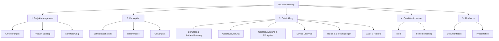
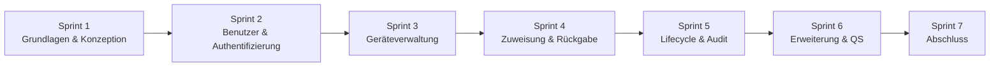

# Projektstudie Mobile Unternehmensanwendungen – Device Inventory

## Abstract

Im Rahmen der Veranstaltung "Projektstudie Entwicklung von mobilen Unternehmensanwendungen (**282160**)" wird eine webbasierte Anwendung zur zentralen Verwaltung von IT-Endgeräten in Unternehmen entwickelt.

Das System soll den gesamten Lebenszyklus von Geräten – von der Erfassung über die Zuweisung an Mitarbeiter bis zur Wartung und Ausmusterung – nachvollziehbar abbilden. Neben der Geräteverwaltung sollen insbesondere Benutzer- und Rollenverwaltung, Statusverwaltung, Gerätezuweisungen sowie eine Historisierung relevanter Änderungen umgesetzt werden.

Ziel ist es, Informationen über den Gerätebestand, den aktuellen Zustand sowie die Zuordnung von Geräten zentral und nachvollziehbar bereitzustellen.

## Projektorganisation

Das Projekt wird durch ein Scrum-Team durchgeführt.

Maximilian Stephan (223702) übernimmt die Rolle des **Product Owners**. Die übrigen Teammitglieder

- Louis Sämann (223519)
- Ümit Emekse (220857)
- Tom Jarolim (222880)
- Michael Pflaum (219241)
- Ali Ahmad (227308)
- Guilliermo Morishige-Takane (224921)

arbeiten als Entwickler.

Die Entwickler übernehmen gemeinsam Aufgaben aus den Bereichen Konzeption, Programmierung, Test und Dokumentation. Die Rolle des **Scrum Masters** übernimmt die Dozentin.

Die konkrete Aufgabenverteilung innerhalb des Entwicklungsteams erfolgt im Rahmen der jeweiligen Sprintplanung. Anforderungen und Entwicklungsaufgaben werden über ein gemeinsames Product Backlog verwaltet und den jeweiligen Sprints zugeordnet.

Für Versionsverwaltung, Zusammenarbeit und Nachvollziehbarkeit der Entwicklung wird GitHub eingesetzt.

## Ausgangssituation / Problemstellung

Unternehmen verwalten eine Vielzahl unterschiedlicher IT-Geräte wie Notebooks, Smartphones, Tablets oder Monitore. Im Verlauf ihres Lebenszyklus werden diese Geräte beschafft, Mitarbeitern zugewiesen, zurückgegeben, gewartet und schließlich ausgemustert.

Dabei müssen Informationen über den vorhandenen Gerätebestand, den aktuellen Gerätestatus sowie die Zuordnung zu Mitarbeitern zentral und nachvollziehbar verwaltet werden. Ohne eine geeignete zentrale Verwaltung kann es schwierig sein festzustellen, welche Geräte aktuell verfügbar oder vergeben sind, welchem Mitarbeiter ein Gerät zugeordnet ist und welche Änderungen in der Vergangenheit vorgenommen wurden.

Das geplante Device Inventory soll diese Informationen zentral verwalten und eine strukturierte und nachvollziehbare Verwaltung des Gerätebestands ermöglichen.

## Fragestellung

Wie kann eine webbasierte Device-Management-Anwendung gestaltet und umgesetzt werden, mit der Unternehmensgeräte und deren Lebenszyklus zentral, rollenbasiert und nachvollziehbar verwaltet werden können?

## Zielsetzung

Ziel des Projekts ist die Konzeption und Entwicklung einer funktionsfähigen webbasierten Device-Management-Anwendung zur zentralen Verwaltung von IT-Endgeräten.

Die Anwendung soll es ermöglichen, Geräte zu erfassen und zu verwalten sowie deren aktuellen Status und Zuordnung zu Mitarbeitern nachvollziehbar abzubilden. Durch ein rollenbasiertes Berechtigungskonzept sollen unterschiedliche Benutzergruppen nur auf die für sie vorgesehenen Funktionen und Daten zugreifen können.

Darüber hinaus sollen Gerätezuweisungen, Rückgaben und relevante Änderungen historisiert werden, sodass der Lebenszyklus eines Gerätes nachvollzogen werden kann.

Das Projekt konzentriert sich auf die Verwaltung und Nachverfolgung von Geräten. Funktionen eines vollständigen Mobile-Device-Management-Systems, wie Fernsteuerung, automatische Geräteerkennung oder Softwareverteilung, sind nicht Bestandteil des Projekts.

## Erwartete Ergebnisse

Als Projektergebnis wird eine lauffähige Webanwendung erwartet, die mindestens folgende Funktionen bereitstellt:

- Benutzeranmeldung und Rollenverwaltung
- Benutzerverwaltung
- Geräteverwaltung
- Gerätezuweisung und -rückgabe
- Verwaltung des Gerätestatus
- Geräte- und Zuweisungshistorie
- Suche und Filterung
- Audit-Logging relevanter Aktionen
- übersichtliche Weboberfläche

Die genannten Funktionen stellen den geplanten Mindestumfang (**MVP – Minimum Viable Product**) der Anwendung dar.

Optional können abhängig vom Projektfortschritt und der Priorisierung des Product Backlogs weitere Funktionen ergänzt werden:

- QR-Codes für Geräte
- Wartungsverwaltung
- CSV-Import und -Export
- Dashboard
- Benachrichtigungen bei anstehenden Wartungen
- Profilverwaltung
- Reservierung bzw. Buchung von Geräten durch Mitarbeiter

Zusätzlich zur Anwendung sollen die im Entwicklungsprozess entstehenden technischen Artefakte wie Softwarearchitektur, Datenmodell, Tests und Dokumentation Bestandteil des Projektergebnisses sein.

## Vorgehensweise der Aktivitäten

Die Entwicklung erfolgt iterativ auf Basis von **Scrum**. Grundlage der Entwicklung bildet ein priorisiertes Product Backlog, in dem die Anforderungen an die Anwendung erfasst und als User Stories bzw. Entwicklungsaufgaben konkretisiert werden.

Eine Iteration dauert gemäß Veranstaltung zwei Wochen; über das Semester sind 6–7 Iterationen vorgesehen.

Zu Beginn jedes Sprints werden im **Sprint Planning** die für den jeweiligen Sprint vorgesehenen Anforderungen aus dem Product Backlog ausgewählt und ein Sprintziel festgelegt.

Innerhalb der Sprints werden insbesondere folgende Aktivitäten durchgeführt:

1. Anforderungen analysieren und konkretisieren
2. Akzeptanzkriterien festlegen
3. Design und Softwarearchitektur entwickeln bzw. erweitern
4. Datenmodell entwickeln bzw. erweitern
5. Funktionen implementieren
6. Funktionen testen
7. Fehler beheben
8. Softwarestand dokumentieren
9. Lauffähigen Softwarestand präsentieren
10. Sprint im Rahmen einer Retrospektive reflektieren

Durch das iterative Vorgehen soll nach jedem Sprint ein funktionsfähiger und gegenüber dem vorherigen Sprint erweiterter Stand der Anwendung entstehen.

## Projektstrukturplan

Der Projektstrukturplan unterteilt das Projekt in die Bereiche Projektmanagement, Konzeption, Entwicklung, Qualitätssicherung und Projektabschluss.

Die einzelnen Bereiche werden im Projektverlauf nicht ausschließlich sequenziell bearbeitet. Insbesondere Entwicklung, Tests und Dokumentation finden wiederkehrend innerhalb der einzelnen Sprints statt.

## Frontend

Das responsive React-/TypeScript-Grundgerüst befindet sich im Verzeichnis [`frontend`](frontend/README.md). Hinweise zum lokalen Start, zu den wiederverwendbaren UI-Komponenten und zu den Integrationspunkten für spätere Fachansichten sind dort dokumentiert.

## Sprint-Projektplan

Die Entwicklung wird in mehrere zweiwöchige Sprints unterteilt. Die konkrete Auswahl und Priorisierung der Anforderungen erfolgt jeweils im Sprint Planning.

Der folgende Sprint-Projektplan stellt daher eine vorläufige Planung der inhaltlichen Schwerpunkte dar. Die konkrete Zuordnung einzelner Anforderungen kann abhängig vom Projektfortschritt und von der Priorisierung des Product Backlogs angepasst werden.

| Sprint | Schwerpunkt | Geplante Inhalte |
|---|---|---|
| **Sprint 1** | Grundlagen & Konzeption | Anforderungen konsolidieren, Product Backlog erstellen, Entwicklungsumgebung einrichten, Softwarearchitektur und Datenmodell entwerfen |
| **Sprint 2** | Benutzer & Authentifizierung | Login/Logout, Benutzerverwaltung, Rollen und Berechtigungen |
| **Sprint 3** | Geräteverwaltung | Geräte anlegen, anzeigen und bearbeiten, Gerätestatus, Suche und Filter |
| **Sprint 4** | Zuweisung & Rückgabe | Geräte Mitarbeitern zuweisen, Geräte zurücknehmen, automatische Statusänderungen |
| **Sprint 5** | Lifecycle & Nachvollziehbarkeit | Zuweisungshistorie, Statushistorie, Audit-Logging |
| **Sprint 6** | Erweiterung & Qualitätssicherung | Optionale Funktionen, automatisierte Tests, Fehlerbehebung und Verbesserung der Benutzeroberfläche |
| **Sprint 7** | Projektabschluss | Systemtests, Fehlerbehebung, Dokumentation und Vorbereitung der Abschlusspräsentation |

