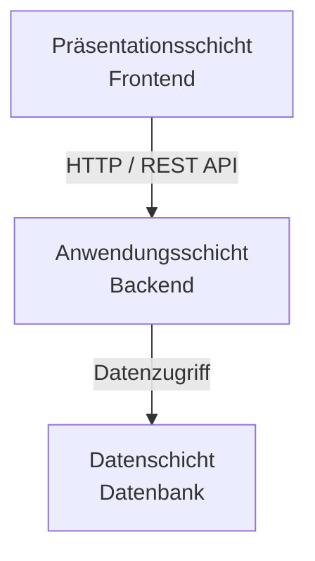
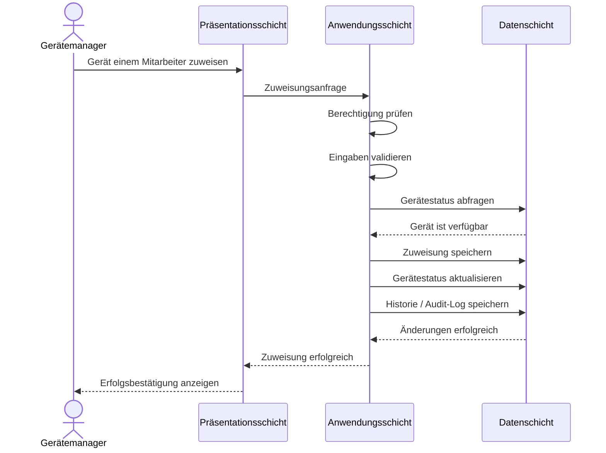

# Softwarearchitektur – Device Inventory

## 1. Überblick

Das **Device Inventory** wird auf Basis einer **3-Schichten-Architektur** entwickelt.

Die Architektur unterteilt die Anwendung in drei logisch voneinander getrennte Schichten:

1. **Präsentationsschicht (Presentation Layer)**
2. **Anwendungsschicht (Application Layer)**
3. **Datenschicht (Data Layer)**

Durch die Trennung der Verantwortlichkeiten soll eine übersichtliche, wartbare und erweiterbare Softwarearchitektur entstehen.

---

## 2. Architekturübersicht

---

## 3. Präsentationsschicht

Die **Präsentationsschicht** stellt die Benutzeroberfläche des Device Inventory bereit.

Sie ist für die Darstellung von Informationen und die Verarbeitung von Benutzereingaben verantwortlich.

### Aufgaben

- Darstellung der Benutzeroberfläche
- Login und Logout
- Darstellung des Gerätebestands
- Anzeige von Gerätedetails
- Formulare zur Erfassung und Bearbeitung von Geräten
- Gerätezuweisung und Rückgabe
- Suche und Filterung
- Darstellung von Historien
- Anzeige von Erfolgs- und Fehlermeldungen
- Responsive Darstellung

Die Präsentationsschicht kommuniziert über HTTP-Anfragen mit der Anwendungsschicht.

---

## 4. Anwendungsschicht

Die **Anwendungsschicht** enthält die zentrale Geschäftslogik der Anwendung und stellt die Schnittstelle zwischen Präsentations- und Datenschicht dar.

### Aufgaben

- Verarbeitung von Anfragen des Frontends
- Authentifizierung
- Autorisierung
- Rollen- und Berechtigungsprüfung
- Benutzerverwaltung
- Geräteverwaltung
- Gerätezuweisung und Rückgabe
- Verwaltung des Device Lifecycle
- Validierung von Eingaben
- Durchsetzung von Geschäftsregeln
- Verwaltung der Gerätehistorie
- Audit-Logging
- Fehlerbehandlung

Geschäftsregeln werden innerhalb der Anwendungsschicht durchgesetzt und nicht ausschließlich im Frontend umgesetzt.

Beispielsweise prüft die Anwendungsschicht bei einer Gerätezuweisung:

- Ist der Benutzer zur Zuweisung berechtigt?
- Existiert das Gerät?
- Existiert der Mitarbeiter?
- Ist das Gerät aktuell verfügbar?
- Besteht bereits eine aktive Zuweisung?
- Ist die gewünschte Statusänderung zulässig?

Erst nach erfolgreicher Prüfung wird die entsprechende Änderung in der Datenschicht gespeichert.

---

## 5. Datenschicht

Die **Datenschicht** ist für die persistente Speicherung und Verwaltung der Daten verantwortlich.

Für das Device Inventory ist eine relationale Datenbank vorgesehen.

### Zu speichernde Daten

Unter anderem werden folgende Daten persistent gespeichert:

- Benutzer
- Rollen
- Geräte
- Gerätetypen
- Gerätestatus
- Gerätezuweisungen
- Rückgaben
- Statushistorie
- Zuweisungshistorie
- Audit-Logs
- optional Wartungen und Defekte

Die Anwendungsschicht greift auf die Datenschicht zu. Ein direkter Zugriff des Frontends auf die Datenbank ist nicht vorgesehen.

---

## 6. Beispiel: Gerätezuweisung

Der Ablauf einer Gerätezuweisung verdeutlicht die Zusammenarbeit der drei Schichten.

---

## 7. Technologische Umsetzung

Die konkreten Technologien werden im Rahmen der Projektentwicklung festgelegt.

Eine mögliche Umsetzung der 3-Schichten-Architektur ist:

| Schicht | Aufgabe | Mögliche Technologie |
|---|---|---|
| Präsentationsschicht | Weboberfläche | React + TypeScript + Vite |
| Anwendungsschicht | REST API und Geschäftslogik | Node.js + TypeScript + Express/Fastify |
| Datenschicht | Persistente Speicherung | PostgreSQL + ORM |

Die Architektur ist grundsätzlich unabhängig von den konkret eingesetzten Programmiersprachen und Frameworks.

---

## 8. Vorteile der Architektur

Die Verwendung einer 3-Schichten-Architektur bietet für das Device Inventory mehrere Vorteile:

- klare Trennung der Verantwortlichkeiten
- übersichtliche Projektstruktur
- bessere Wartbarkeit
- einfachere Erweiterbarkeit
- Frontend und Backend können getrennt entwickelt werden
- Geschäftslogik wird zentral im Backend umgesetzt
- Datenbank ist nicht direkt über das Frontend erreichbar
- einzelne Schichten können unabhängig getestet werden