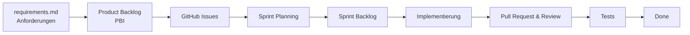

# Product Backlog – Device Inventory

## 1. Zweck

Dieses Dokument enthält den Product Backlog für das Projekt **Device Inventory**.

Der Product Backlog enthält die aktuell bekannten Anforderungen und Arbeitspakete des Projekts. Die Einträge werden während des Projektverlaufs durch den Product Owner priorisiert, konkretisiert und bei Bedarf ergänzt oder angepasst.

Die Umsetzung erfolgt iterativ innerhalb der einzelnen Sprints. Im Sprint Planning werden geeignete Product Backlog Items ausgewählt und in den jeweiligen Sprint Backlog übernommen.

---

## 2. Priorisierung

Die Priorisierung der Product Backlog Items erfolgt nach folgendem Schema:

| Priorität | Bedeutung |
|---|---|
| **Must** | Für den funktionsfähigen Mindestumfang (MVP) erforderlich |
| **Should** | Hoher Mehrwert, soll nach Möglichkeit umgesetzt werden |
| **Could** | Optionale Erweiterung bei ausreichender Zeit |

---

## 3. Aufwandsschätzung

Der Aufwand der Product Backlog Items wird im Team relativ mithilfe von Story Points geschätzt.

Vorgesehene Werte:

`1` – `2` – `3` – `5` – `8` – `13`

Die Story Points werden im Rahmen der Sprintplanung bzw. des Backlog Refinements durch das Entwicklungsteam festgelegt.

---

# 4. Product Backlog

| ID | Product Backlog Item | Typ | Priorität | Anforderungen | Story Points | Status |
|---|---|---|---|---|---|---|
| **PBI-01** | Projektgrundlage und Entwicklungsumgebung einrichten | Technical Task | Must | – | TBD | Backlog |
| **PBI-02** | Grundlegendes Datenmodell erstellen | Technical Task | Must | – | TBD | Backlog |
| **PBI-03** | Benutzer anmelden und abmelden | User Story | Must | FA-01, NFA-01, NFA-03 | TBD | Backlog |
| **PBI-04** | Benutzer verwalten | User Story | Must | FA-02 | TBD | Backlog |
| **PBI-05** | Rollen und Berechtigungen verwalten | User Story | Must | FA-03, FA-04, NFA-02 | TBD | Backlog |
| **PBI-06** | Gerät erfassen | User Story | Must | FA-05, FA-06 | TBD | Backlog |
| **PBI-07** | Gerätedaten anzeigen und bearbeiten | User Story | Must | FA-05, FA-06 | TBD | Backlog |
| **PBI-08** | Gerätestatus verwalten | User Story | Must | FA-07 | TBD | Backlog |
| **PBI-09** | Geräte suchen und filtern | User Story | Must | FA-15, FA-16 | TBD | Backlog |
| **PBI-10** | Gerät einem Mitarbeiter zuweisen | User Story | Must | FA-08, FA-09, FA-10, NFA-05 | TBD | Backlog |
| **PBI-11** | Gerät von einem Mitarbeiter zurücknehmen | User Story | Must | FA-11, FA-12, FA-13 | TBD | Backlog |
| **PBI-12** | Geräte- und Zuweisungshistorie anzeigen | User Story | Must | FA-14 | TBD | Backlog |
| **PBI-13** | Kritische Aktionen bestätigen | User Story | Must | FA-17 | TBD | Backlog |
| **PBI-14** | Benutzer über erfolgreiche und fehlerhafte Aktionen informieren | User Story | Must | FA-18, FA-19 | TBD | Backlog |
| **PBI-15** | Audit-Log erstellen und anzeigen | User Story | Must | FA-20, FA-21 | TBD | Backlog |
| **PBI-16** | Automatisierte Tests für Kernfunktionen erstellen | Technical Task | Must | NFA-13 | TBD | Backlog |
| **PBI-17** | Responsive und benutzerfreundliche Oberfläche umsetzen | Technical Task | Must | NFA-08, NFA-10 | TBD | Backlog |
| **PBI-18** | Wartungen und Defekte verwalten | User Story | Should | FA-22, FA-23, FA-25 | TBD | Backlog |
| **PBI-19** | Wartungstermine verwalten | User Story | Could | FA-24 | TBD | Backlog |
| **PBI-20** | Dashboard bereitstellen | User Story | Could | FA-26 | TBD | Backlog |
| **PBI-21** | QR-Code für Geräte bereitstellen | User Story | Could | FA-27 | TBD | Backlog |
| **PBI-22** | Wartungsbenachrichtigungen bereitstellen | User Story | Could | FA-28 | TBD | Backlog |
| **PBI-23** | Benutzerprofil verwalten | User Story | Could | FA-29 | TBD | Backlog |
| **PBI-24** | CSV-Import und -Export bereitstellen | User Story | Could | – | TBD | Backlog |
| **PBI-25** | Barrierefreiheit der Benutzeroberfläche verbessern | Technical Task | Should | NFA-11 | TBD | Backlog |
| **PBI-26** | Datensicherung und Wiederherstellung ermöglichen | Technical Task | Should | NFA-14 | TBD | Backlog |

---

# 5. Product Backlog Items

## PBI-01 – Projektgrundlage und Entwicklungsumgebung einrichten

**Typ:** Technical Task  
**Priorität:** Must  
**Status:** Backlog  
**Story Points:** TBD

### Beschreibung

Die technische Grundlage für die gemeinsame Entwicklung der Anwendung soll eingerichtet werden. Dazu gehören die grundlegende Projektstruktur, die lokale Entwicklungsumgebung und die notwendigen Abhängigkeiten.

### Akzeptanzkriterien

- [ ] Projekt kann lokal gestartet werden.
- [ ] Grundlegende Projektstruktur ist vorhanden.
- [ ] Abhängigkeiten sind dokumentiert.
- [ ] Alle Entwickler können die Entwicklungsumgebung verwenden.
- [ ] Vorgehen zum lokalen Start der Anwendung ist dokumentiert.

---

## PBI-02 – Grundlegendes Datenmodell erstellen

**Typ:** Technical Task  
**Priorität:** Must  
**Status:** Backlog  
**Story Points:** TBD

### Beschreibung

Für die Anwendung soll ein relationales Datenmodell entwickelt werden, das die grundlegenden Entitäten und Beziehungen des Device Inventory abbildet.

### Akzeptanzkriterien

- [ ] Benutzer können im Datenmodell abgebildet werden.
- [ ] Geräte können im Datenmodell abgebildet werden.
- [ ] Rollen können Benutzern zugeordnet werden.
- [ ] Gerätezuweisungen können gespeichert werden.
- [ ] Historische Zuweisungen können gespeichert werden.
- [ ] Gerätestatus können abgebildet werden.

---

## PBI-03 – Benutzer anmelden und abmelden

**Typ:** User Story  
**Priorität:** Must  
**Anforderungen:** FA-01, NFA-01, NFA-03  
**Status:** Backlog  
**Story Points:** TBD

### User Story

Als Benutzer möchte ich mich am Device Inventory anmelden und wieder abmelden können, damit ich entsprechend meiner Berechtigungen auf das System zugreifen kann.

### Akzeptanzkriterien

- [ ] Benutzer können sich mit ihren Zugangsdaten anmelden.
- [ ] Ungültige Zugangsdaten werden abgelehnt.
- [ ] Passwörter werden nicht im Klartext gespeichert.
- [ ] Angemeldete Benutzer können sich abmelden.
- [ ] Geschützte Bereiche sind ohne Anmeldung nicht zugänglich.
- [ ] Benutzersitzungen laufen nach der festgelegten Inaktivitätszeit ab.

---

## PBI-04 – Benutzer verwalten

**Typ:** User Story  
**Priorität:** Must  
**Anforderungen:** FA-02  
**Status:** Backlog  
**Story Points:** TBD

### User Story

Als Administrator möchte ich Benutzerkonten verwalten können, damit die berechtigten Mitarbeiter Zugriff auf das Device Inventory erhalten.

### Akzeptanzkriterien

- [ ] Administratoren können Benutzer anlegen.
- [ ] Administratoren können Benutzerdaten bearbeiten.
- [ ] Administratoren können Benutzer deaktivieren.
- [ ] Deaktivierte Benutzer können sich nicht mehr anmelden.
- [ ] Unberechtigte Benutzer können die Benutzerverwaltung nicht aufrufen.

---

## PBI-05 – Rollen und Berechtigungen verwalten

**Typ:** User Story  
**Priorität:** Must  
**Anforderungen:** FA-03, FA-04, NFA-02  
**Status:** Backlog  
**Story Points:** TBD

### User Story

Als Administrator möchte ich Benutzern Rollen zuweisen können, damit der Zugriff auf Funktionen und Daten entsprechend der jeweiligen Aufgabe eingeschränkt werden kann.

### Akzeptanzkriterien

- [ ] Benutzer können einer Rolle zugeordnet werden.
- [ ] Die Rollen Administrator, Gerätemanager und Mitarbeiter werden unterstützt.
- [ ] Funktionen werden abhängig von der Benutzerrolle freigegeben.
- [ ] Nicht berechtigte Zugriffe werden verhindert.
- [ ] Mitarbeiter können nur die für sie vorgesehenen Daten einsehen.

---

## PBI-06 – Gerät erfassen

**Typ:** User Story  
**Priorität:** Must  
**Anforderungen:** FA-05, FA-06  
**Status:** Backlog  
**Story Points:** TBD

### User Story

Als Gerätemanager möchte ich neue Geräte erfassen können, damit diese zentral im Gerätebestand verwaltet werden können.

### Akzeptanzkriterien

- [ ] Ein neues Gerät kann angelegt werden.
- [ ] Eine eindeutige Geräte-ID wird gespeichert.
- [ ] Gerätetyp kann gespeichert werden.
- [ ] Hersteller kann gespeichert werden.
- [ ] Modell kann gespeichert werden.
- [ ] Seriennummer kann gespeichert werden.
- [ ] Pflichtfelder werden validiert.
- [ ] Das neu angelegte Gerät wird im Gerätebestand angezeigt.

---

## PBI-07 – Gerätedaten anzeigen und bearbeiten

**Typ:** User Story  
**Priorität:** Must  
**Anforderungen:** FA-05, FA-06  
**Status:** Backlog  
**Story Points:** TBD

### User Story

Als Gerätemanager möchte ich die Daten eines vorhandenen Gerätes anzeigen und bearbeiten können, damit der Gerätebestand aktuell gehalten werden kann.

### Akzeptanzkriterien

- [ ] Gerätedetails können angezeigt werden.
- [ ] Berechtigte Benutzer können Gerätedaten bearbeiten.
- [ ] Änderungen werden gespeichert.
- [ ] Pflichtfelder werden validiert.
- [ ] Unberechtigte Benutzer können Gerätedaten nicht verändern.

---

## PBI-08 – Gerätestatus verwalten

**Typ:** User Story  
**Priorität:** Must  
**Anforderungen:** FA-07  
**Status:** Backlog  
**Story Points:** TBD

### User Story

Als Gerätemanager möchte ich den aktuellen Status eines Gerätes verwalten können, damit der Zustand und die Verfügbarkeit eines Gerätes ersichtlich sind.

### Unterstützte Status

- `Verfügbar`
- `Zugewiesen`
- `Defekt`
- `Wartung`
- `Ausgemustert`

### Akzeptanzkriterien

- [ ] Jedes Gerät besitzt einen aktuellen Status.
- [ ] Der aktuelle Status wird in der Gerätedetailansicht angezeigt.
- [ ] Berechtigte Benutzer können zulässige Statusänderungen durchführen.
- [ ] Ungültige Statusänderungen werden verhindert.

---

## PBI-09 – Geräte suchen und filtern

**Typ:** User Story  
**Priorität:** Must  
**Anforderungen:** FA-15, FA-16  
**Status:** Backlog  
**Story Points:** TBD

### User Story

Als Benutzer möchte ich den Gerätebestand durchsuchen und filtern können, damit ich benötigte Geräte schnell finden kann.

### Akzeptanzkriterien

- [ ] Geräte können anhand relevanter Attribute gesucht werden.
- [ ] Geräte können nach Status gefiltert werden.
- [ ] Geräte können nach Gerätetyp gefiltert werden.
- [ ] Geräte können nach zugewiesenem Mitarbeiter gefiltert werden.
- [ ] Mehrere Filter können kombiniert werden.
- [ ] Filter können zurückgesetzt werden.

---

## PBI-10 – Gerät einem Mitarbeiter zuweisen

**Typ:** User Story  
**Priorität:** Must  
**Anforderungen:** FA-08, FA-09, FA-10, NFA-05  
**Status:** Backlog  
**Story Points:** TBD

### User Story

Als Gerätemanager möchte ich ein verfügbares Gerät einem Mitarbeiter zuweisen können, damit nachvollziehbar ist, wer das Gerät aktuell verwendet.

### Akzeptanzkriterien

- [ ] Nur verfügbare Geräte können zugewiesen werden.
- [ ] Ein Mitarbeiter kann ausgewählt werden.
- [ ] Gerät und Mitarbeiter werden gespeichert.
- [ ] Zeitpunkt der Zuweisung wird gespeichert.
- [ ] Der durchführende Benutzer wird gespeichert.
- [ ] Der Gerätestatus wird automatisch auf `Zugewiesen` gesetzt.
- [ ] Ein Gerät kann nicht gleichzeitig mehreren Mitarbeitern aktiv zugewiesen sein.
- [ ] Die Zuweisung wird in der Gerätehistorie gespeichert.

---

## PBI-11 – Gerät von einem Mitarbeiter zurücknehmen

**Typ:** User Story  
**Priorität:** Must  
**Anforderungen:** FA-11, FA-12, FA-13  
**Status:** Backlog  
**Story Points:** TBD

### User Story

Als Gerätemanager möchte ich ein zugewiesenes Gerät zurücknehmen können, damit es anschließend wieder verwaltet oder einem anderen Mitarbeiter zugewiesen werden kann.

### Akzeptanzkriterien

- [ ] Ein aktuell zugewiesenes Gerät kann zurückgenommen werden.
- [ ] Der Rückgabezeitpunkt wird gespeichert.
- [ ] Die aktive Zuweisung wird beendet.
- [ ] Das Gerät wird wieder als `Verfügbar` markiert, sofern kein Defekt oder Wartungsfall vorliegt.
- [ ] Die abgeschlossene Zuweisung bleibt in der Historie erhalten.

---

## PBI-12 – Geräte- und Zuweisungshistorie anzeigen

**Typ:** User Story  
**Priorität:** Must  
**Anforderungen:** FA-14  
**Status:** Backlog  
**Story Points:** TBD

### User Story

Als Gerätemanager möchte ich die Historie eines Gerätes einsehen können, damit vergangene Zuweisungen und Statusänderungen nachvollziehbar sind.

### Akzeptanzkriterien

- [ ] Vergangene Zuweisungen werden angezeigt.
- [ ] Beginn und Ende einer Zuweisung werden angezeigt.
- [ ] Zugewiesene Mitarbeiter werden angezeigt.
- [ ] Relevante Statusänderungen werden nachvollziehbar dargestellt.
- [ ] Historische Daten bleiben nach einer Rückgabe erhalten.

---

## PBI-13 – Kritische Aktionen bestätigen

**Typ:** User Story  
**Priorität:** Must  
**Anforderungen:** FA-17  
**Status:** Backlog  
**Story Points:** TBD

### User Story

Als Benutzer möchte ich bei kritischen Aktionen eine zusätzliche Bestätigung erhalten, damit unbeabsichtigte Änderungen vermieden werden.

### Akzeptanzkriterien

- [ ] Kritische Aktionen erfordern eine zusätzliche Bestätigung.
- [ ] Das Ausmustern eines Gerätes erfordert eine Bestätigung.
- [ ] Die Aktion kann vor der endgültigen Durchführung abgebrochen werden.

---

## PBI-14 – Benutzer über Aktionen informieren

**Typ:** User Story  
**Priorität:** Must  
**Anforderungen:** FA-18, FA-19  
**Status:** Backlog  
**Story Points:** TBD

### User Story

Als Benutzer möchte ich verständliche Rückmeldungen zu meinen Aktionen erhalten, damit ich erkennen kann, ob eine Aktion erfolgreich war oder ein Fehler aufgetreten ist.

### Akzeptanzkriterien

- [ ] Erfolgreiche Aktionen werden bestätigt.
- [ ] Ungültige Eingaben erzeugen verständliche Fehlermeldungen.
- [ ] Fehlermeldungen enthalten keine sensiblen Systeminformationen.
- [ ] Fehlermeldungen geben möglichst einen Hinweis auf die Ursache des Problems.

---

## PBI-15 – Audit-Log erstellen und anzeigen

**Typ:** User Story  
**Priorität:** Must  
**Anforderungen:** FA-20, FA-21  
**Status:** Backlog  
**Story Points:** TBD

### User Story

Als Administrator möchte ich relevante Aktionen im Audit-Log einsehen können, damit Änderungen im System nachvollziehbar sind.

### Akzeptanzkriterien

- [ ] Relevante Aktionen werden protokolliert.
- [ ] Der ausführende Benutzer wird gespeichert.
- [ ] Die durchgeführte Aktion wird gespeichert.
- [ ] Der Zeitpunkt wird gespeichert.
- [ ] Nur berechtigte Benutzer können das Audit-Log einsehen.

---

## PBI-16 – Automatisierte Tests für Kernfunktionen erstellen

**Typ:** Technical Task  
**Priorität:** Must  
**Anforderungen:** NFA-13  
**Status:** Backlog  
**Story Points:** TBD

### Beschreibung

Zentrale Geschäftsprozesse der Anwendung sollen durch automatisierte Tests abgesichert werden.

### Akzeptanzkriterien

- [ ] Gerätezuweisung wird automatisiert getestet.
- [ ] Geräterückgabe wird automatisiert getestet.
- [ ] Zentrale Berechtigungsregeln werden getestet.
- [ ] Ungültige Geschäftsprozesse werden getestet.
- [ ] Tests können reproduzierbar ausgeführt werden.

---

## PBI-17 – Responsive und benutzerfreundliche Oberfläche umsetzen

**Typ:** Technical Task  
**Priorität:** Must  
**Anforderungen:** NFA-08, NFA-10  
**Status:** Backlog  
**Story Points:** TBD

### Beschreibung

Die Benutzeroberfläche soll übersichtlich gestaltet und auf unterschiedlichen Bildschirmgrößen nutzbar sein.

### Akzeptanzkriterien

- [ ] Anwendung ist auf Desktop-PCs nutzbar.
- [ ] Anwendung ist auf Tablets nutzbar.
- [ ] Anwendung ist auf Smartphones nutzbar.
- [ ] Navigation ist einheitlich gestaltet.
- [ ] Zentrale Funktionen sind verständlich erreichbar.

---

# 6. Optionale Product Backlog Items

Die folgenden Product Backlog Items werden abhängig vom Projektfortschritt und der Priorisierung umgesetzt.

## PBI-18 – Wartungen und Defekte verwalten

**Typ:** User Story  
**Priorität:** Should  
**Anforderungen:** FA-22, FA-23, FA-25  
**Status:** Backlog  
**Story Points:** TBD

### User Story

Als Gerätemanager möchte ich Defekte und Wartungen eines Gerätes dokumentieren können, damit der technische Zustand eines Gerätes nachvollziehbar ist.

### Akzeptanzkriterien

- [ ] Defekte können dokumentiert werden.
- [ ] Wartungen können angelegt werden.
- [ ] Datum und Beschreibung können gespeichert werden.
- [ ] Ein Bearbeitungsstatus kann gespeichert werden.
- [ ] Nach Abschluss einer Wartung kann das Gerät in einen geeigneten Status überführt werden.

---

## PBI-19 – Wartungstermine verwalten

**Typ:** User Story  
**Priorität:** Could  
**Anforderungen:** FA-24  
**Status:** Backlog  
**Story Points:** TBD

### User Story

Als Gerätemanager möchte ich zukünftige Wartungstermine hinterlegen können, damit anstehende Wartungen geplant werden können.

---

## PBI-20 – Dashboard bereitstellen

**Typ:** User Story  
**Priorität:** Could  
**Anforderungen:** FA-26  
**Status:** Backlog  
**Story Points:** TBD

### User Story

Als Gerätemanager möchte ich eine Übersicht über den Gerätebestand erhalten, damit ich wichtige Kennzahlen schnell erfassen kann.

### Mögliche Inhalte

- Anzahl der Geräte
- Geräte nach Status
- Geräte nach Typ
- Anzahl zugewiesener Geräte
- Anzahl verfügbarer Geräte
- Anstehende Wartungen

---

## PBI-21 – QR-Code für Geräte bereitstellen

**Typ:** User Story  
**Priorität:** Could  
**Anforderungen:** FA-27  
**Status:** Backlog  
**Story Points:** TBD

### User Story

Als Gerätemanager möchte ich für ein Gerät einen QR-Code erzeugen können, damit die Detailseite des Gerätes schnell aufgerufen werden kann.

### Akzeptanzkriterien

- [ ] Für ein Gerät kann ein QR-Code erzeugt werden.
- [ ] Der QR-Code verweist auf die entsprechende Gerätedetailseite.
- [ ] Der QR-Code kann mit einem geeigneten Gerät gescannt werden.

---

## PBI-22 – Wartungsbenachrichtigungen bereitstellen

**Typ:** User Story  
**Priorität:** Could  
**Anforderungen:** FA-28  
**Status:** Backlog  
**Story Points:** TBD

### User Story

Als Gerätemanager möchte ich auf anstehende Wartungen hingewiesen werden, damit Wartungstermine nicht übersehen werden.

---

## PBI-23 – Benutzerprofil verwalten

**Typ:** User Story  
**Priorität:** Could  
**Anforderungen:** FA-29  
**Status:** Backlog  
**Story Points:** TBD

### User Story

Als Benutzer möchte ich bestimmte Daten meines eigenen Profils einsehen und bearbeiten können.

---

## PBI-24 – CSV-Import und -Export bereitstellen

**Typ:** User Story  
**Priorität:** Could  
**Status:** Backlog  
**Story Points:** TBD

### User Story

Als Gerätemanager möchte ich Gerätedaten über CSV-Dateien importieren und exportieren können, damit größere Datenbestände einfacher übertragen werden können.

---

## PBI-25 – Barrierefreiheit verbessern

**Typ:** Technical Task  
**Priorität:** Should  
**Anforderungen:** NFA-11  
**Status:** Backlog  
**Story Points:** TBD

### Akzeptanzkriterien

- [ ] Wesentliche Funktionen sind per Tastatur bedienbar.
- [ ] Bedienelemente sind eindeutig beschriftet.
- [ ] Die Oberfläche verwendet gut lesbare Kontraste.

---

## PBI-26 – Datensicherung und Wiederherstellung ermöglichen

**Typ:** Technical Task  
**Priorität:** Should  
**Anforderungen:** NFA-14  
**Status:** Backlog  
**Story Points:** TBD

### Beschreibung

Die persistent gespeicherten Anwendungsdaten sollen gesichert und im Bedarfsfall wiederhergestellt werden können.

---

# 7. Vorläufige Sprint-Zuordnung

Die folgende Zuordnung dient lediglich als erste Planung. Die tatsächliche Auswahl der Product Backlog Items erfolgt im jeweiligen Sprint Planning.

| Sprint | Schwerpunkt | Mögliche Product Backlog Items |
|---|---|---|
| **Sprint 1** | Grundlagen & Konzeption | PBI-01, PBI-02 |
| **Sprint 2** | Benutzer & Authentifizierung | PBI-03, PBI-04, PBI-05 |
| **Sprint 3** | Geräteverwaltung | PBI-06, PBI-07, PBI-08, PBI-09 |
| **Sprint 4** | Zuweisung & Rückgabe | PBI-10, PBI-11, PBI-13, PBI-14 |
| **Sprint 5** | Lifecycle & Nachvollziehbarkeit | PBI-12, PBI-15 |
| **Sprint 6** | Qualität & Erweiterungen | PBI-16, PBI-17 sowie priorisierte optionale PBIs |
| **Sprint 7** | Abschluss | Systemtests, Fehlerbehebung, Dokumentation und Abschlusspräsentation |

---

# 8. Zusammenhang mit dem Anforderungskatalog

Die IDs der Anforderungen aus `requirements.md` werden in den jeweiligen Product Backlog Items referenziert. Dadurch bleibt nachvollziehbar, durch welches Product Backlog Item eine Anforderung umgesetzt wird.

---

# 9. Definition of Done

Ein Product Backlog Item gilt als **Done**, wenn die für das Item relevanten folgenden Kriterien erfüllt sind:

- [ ] Alle Akzeptanzkriterien sind erfüllt.
- [ ] Die Implementierung ist abgeschlossen.
- [ ] Der Code wurde in das Projekt integriert.
- [ ] Relevante Tests wurden erfolgreich durchgeführt.
- [ ] Es bestehen keine bekannten kritischen Fehler.
- [ ] Rollen und Berechtigungen wurden berücksichtigt.
- [ ] Relevante Dokumentation wurde aktualisiert.
- [ ] Das Product Backlog Item kann im aktuellen Softwarestand demonstriert werden.

---

# 10. Pflege des Product Backlogs

Der Product Backlog ist ein lebendes Dokument und kann während des Projekts angepasst werden.

Der Product Owner ist insbesondere für folgende Aufgaben verantwortlich:

- Product Backlog pflegen
- Product Backlog Items priorisieren
- Anforderungen konkretisieren
- Neue Product Backlog Items aufnehmen
- Nicht mehr relevante Einträge entfernen oder zurückstellen
- Abstimmung mit dem Entwicklungsteam
- Vorbereitung der Anforderungen für kommende Sprints

Die Aufwandsschätzung erfolgt gemeinsam durch das Entwicklungsteam.

---

# 11. Änderungsverlauf

| Version | Datum | Änderung |
|---|---|---|
| **0.1** | 16.10.2026 | Initialer Product Backlog auf Grundlage des Anforderungskatalogs |