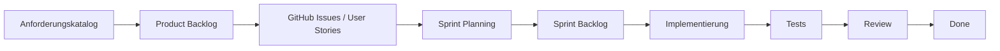

# Device Inventory – Anforderungen

## 1. Rollen

Das Device Inventory unterscheidet zwischen verschiedenen Benutzerrollen mit unterschiedlichen Berechtigungen.

| Rolle | Berechtigungen |
|---|---|
| **Administrator** | Vollzugriff auf das System, Benutzer- und Rollenverwaltung, Audit-Log einsehen |
| **Gerätemanager** | Geräte anlegen und bearbeiten, Geräte zuweisen und zurücknehmen, Gerätestatus verwalten |
| **Mitarbeiter** | Eigene zugewiesene Geräte und deren Informationen einsehen |

> Die Möglichkeit, dass Mitarbeiter selbstständig Geräte buchen oder reservieren können, wird zunächst als optionale Erweiterung betrachtet.

---

## 2. Funktionale Anforderungen

Die funktionalen Anforderungen beschreiben die Funktionen, die das Device Inventory bereitstellen muss.

| ID | Anforderung | Priorität |
|---|---|---|
| **FA-01** | Das System muss registrierten Benutzern die Anmeldung und Abmeldung ermöglichen. | Muss |
| **FA-02** | Administratoren müssen Benutzerkonten anlegen, bearbeiten und deaktivieren können. | Muss |
| **FA-03** | Administratoren müssen Benutzern Rollen zuweisen können. | Muss |
| **FA-04** | Das System muss den Zugriff auf Funktionen und Daten anhand der Benutzerrolle beschränken. | Muss |
| **FA-05** | Berechtigte Benutzer müssen Geräte anlegen, anzeigen und bearbeiten können. | Muss |
| **FA-06** | Geräte müssen mindestens über eine eindeutige Geräte-ID sowie Typ, Hersteller, Modell und Seriennummer verfügen können. | Muss |
| **FA-07** | Das System muss die Gerätestatus `Verfügbar`, `Zugewiesen`, `Defekt`, `Wartung` und `Ausgemustert` unterstützen. | Muss |
| **FA-08** | Berechtigte Benutzer müssen ein verfügbares Gerät einem Mitarbeiter zuweisen können. | Muss |
| **FA-09** | Bei einer Zuweisung müssen Gerät, Mitarbeiter, Zeitpunkt und durchführender Benutzer gespeichert werden. | Muss |
| **FA-10** | Nach einer erfolgreichen Zuweisung muss der Gerätestatus automatisch auf `Zugewiesen` gesetzt werden. | Muss |
| **FA-11** | Berechtigte Benutzer müssen ein zugewiesenes Gerät zurücknehmen können. | Muss |
| **FA-12** | Bei einer Rückgabe muss der Rückgabezeitpunkt gespeichert werden. | Muss |
| **FA-13** | Nach einer erfolgreichen Rückgabe muss das Gerät auf `Verfügbar` gesetzt werden, sofern kein Defekt oder Wartungsfall vorliegt. | Muss |
| **FA-14** | Das System muss für jedes Gerät eine Zuweisungs- und Statushistorie führen. | Muss |
| **FA-15** | Benutzer müssen Geräte anhand relevanter Attribute suchen können. | Muss |
| **FA-16** | Geräte müssen nach Status, Typ und zugewiesenem Mitarbeiter gefiltert werden können. | Muss |
| **FA-17** | Kritische Aktionen wie das Ausmustern eines Gerätes müssen vom Benutzer zusätzlich bestätigt werden. | Muss |
| **FA-18** | Erfolgreiche Aktionen müssen dem Benutzer bestätigt werden. | Muss |
| **FA-19** | Bei ungültigen Eingaben muss eine verständliche Fehlermeldung angezeigt werden. | Muss |
| **FA-20** | Relevante Änderungen müssen mit Benutzer, Aktion und Zeitpunkt in einem Audit-Log protokolliert werden. | Muss |
| **FA-21** | Administratoren müssen das Audit-Log einsehen können. | Muss |

---

## 3. Optionale funktionale Anforderungen

Die folgenden Funktionen sind nicht zwingend für die erste funktionsfähige Version erforderlich und können in späteren Sprints umgesetzt werden.

| ID | Anforderung |
|---|---|
| **FA-22** | Defekte eines Gerätes können dokumentiert werden. |
| **FA-23** | Wartungen können mit Datum, Beschreibung und Bearbeitungsstatus dokumentiert werden. |
| **FA-24** | Für Wartungen kann ein nächster Wartungstermin hinterlegt werden. |
| **FA-25** | Nach Abschluss einer Wartung kann das Gerät wieder in einen geeigneten Gerätestatus überführt werden. |
| **FA-26** | Das System stellt ein Dashboard mit Kennzahlen zum Gerätebestand bereit. |
| **FA-27** | Für Geräte kann ein QR-Code erzeugt werden, der auf die jeweilige Gerätedetailseite verweist. |
| **FA-28** | Das System kann Benutzer über anstehende Wartungstermine informieren. |
| **FA-29** | Benutzer können bestimmte Daten ihres eigenen Profils verwalten. |

---

## 4. Nicht-funktionale Anforderungen

Die nicht-funktionalen Anforderungen beschreiben Qualitätsmerkmale und technische Rahmenbedingungen der Anwendung.

| ID | Kategorie | Anforderung |
|---|---|---|
| **NFA-01** | Sicherheit | Passwörter dürfen nicht im Klartext gespeichert werden, sondern müssen mit einem geeigneten Passwort-Hashing-Verfahren gespeichert werden. |
| **NFA-02** | Datenschutz | Personenbezogene und administrative Daten dürfen nur für entsprechend berechtigte Benutzer zugänglich sein. |
| **NFA-03** | Sitzungsverwaltung | Benutzersitzungen müssen nach 30 Minuten Inaktivität automatisch ablaufen. |
| **NFA-04** | Fehlerbehandlung | Fehlermeldungen dürfen keine sensiblen System-, Datenbank- oder Authentifizierungsinformationen offenlegen. |
| **NFA-05** | Datenintegrität | Ein Gerät darf zu einem Zeitpunkt höchstens einem Mitarbeiter aktiv zugewiesen sein. |
| **NFA-06** | Datenkonsistenz | Zusammengehörige Datenbankänderungen müssen vollständig durchgeführt oder vollständig zurückgesetzt werden. |
| **NFA-07** | Performance | Die wichtigsten Seiten sollen bei bis zu 20 gleichzeitig aktiven Benutzern innerhalb von 3 Sekunden geladen werden. |
| **NFA-08** | Responsivität | Die Webanwendung muss auf Desktop-PCs, Tablets und Smartphones nutzbar sein. |
| **NFA-09** | Browserkompatibilität | Die Anwendung muss mit aktuellen Versionen von Chrome, Firefox und Edge funktionieren. |
| **NFA-10** | Benutzerfreundlichkeit | Die Benutzeroberfläche muss einheitlich, übersichtlich und verständlich gestaltet sein. |
| **NFA-11** | Barrierefreiheit | Wesentliche Funktionen sollen per Tastatur bedienbar sein und die Oberfläche soll ausreichende Kontraste verwenden. |
| **NFA-12** | Wartbarkeit | Der Quellcode muss modular aufgebaut und nachvollziehbar dokumentiert sein. |
| **NFA-13** | Testbarkeit | Zentrale Geschäftsprozesse, insbesondere Gerätezuweisung und Rückgabe, müssen durch automatisierte Tests überprüft werden. |
| **NFA-14** | Datensicherung | Die persistierten Anwendungsdaten müssen gesichert und wiederhergestellt werden können. |

---

## 5. Projektabgrenzung / Nicht-Anforderungen

Um den Umfang des Projekts klar einzugrenzen, sind die folgenden Funktionen **nicht Bestandteil des Projekts**:

- Es wird **keine native Android- oder iOS-Anwendung** entwickelt.
- Geräte werden **nicht automatisch im Unternehmensnetzwerk erkannt**.
- Eine **Fernsteuerung oder Fernwartung** von Geräten ist nicht Bestandteil des Systems.
- Eine Integration in ERP-Systeme wie SAP ist nicht vorgesehen.
- Die Anwendung übernimmt **keine automatische Installation oder Aktualisierung von Software** auf verwalteten Geräten.
- Eine Integration mit **Active Directory oder Microsoft Entra ID** ist nicht vorgesehen.
- Hardwarezustände wie CPU-Auslastung, Arbeitsspeicher oder Akkuzustand werden **nicht automatisch überwacht**.
- Eine vollständige Offline-Nutzung ohne Serververbindung ist nicht vorgesehen.
- Das System ist **nicht mandantenfähig** und verwaltet somit nicht mehrere unabhängige Unternehmen.

---

## 6. Umsetzung der Anforderungen in GitHub

Die Anforderungen dienen als Grundlage für den **Product Backlog**.

Dabei muss nicht jede einzelne Anforderung einem eigenen GitHub Issue entsprechen. Fachlich zusammengehörige Anforderungen können in einer **User Story** zusammengefasst werden.

### Beispiel: Gerätezuweisung

Die Anforderungen `FA-08`, `FA-09`, `FA-10` und `NFA-05` können beispielsweise gemeinsam durch eine User Story umgesetzt werden.

```markdown
## User Story

Als Gerätemanager möchte ich ein verfügbares Gerät einem Mitarbeiter
zuweisen können, damit die aktuelle Nutzung des Gerätes nachvollziehbar ist.

## Zugehörige Anforderungen

- FA-08
- FA-09
- FA-10
- NFA-05

## Akzeptanzkriterien

- [ ] Nur verfügbare Geräte können zugewiesen werden.
- [ ] Ein Mitarbeiter kann ausgewählt werden.
- [ ] Gerät und Mitarbeiter werden gespeichert.
- [ ] Zeitpunkt der Zuweisung wird gespeichert.
- [ ] Durchführender Benutzer wird gespeichert.
- [ ] Gerätestatus wird automatisch auf `Zugewiesen` gesetzt.
- [ ] Ein Gerät kann nicht gleichzeitig mehreren Mitarbeitern zugewiesen sein.
- [ ] Die Zuweisung erscheint in der Gerätehistorie.
```

---

## 7. Zusammenhang zwischen Anforderungen, Issues und Sprints



### Anforderungskatalog

Beschreibt, **was das Gesamtsystem können muss**.

### GitHub Issues / User Stories

Beschreiben, **welcher fachliche Mehrwert implementiert werden soll**.

### Akzeptanzkriterien

Beschreiben, **wann eine User Story als erfolgreich umgesetzt gilt**.

### Sprint

Bestimmt, **wann die User Story umgesetzt werden soll**.

### Tests

Überprüfen, **ob die Anforderungen und Akzeptanzkriterien tatsächlich erfüllt sind**.