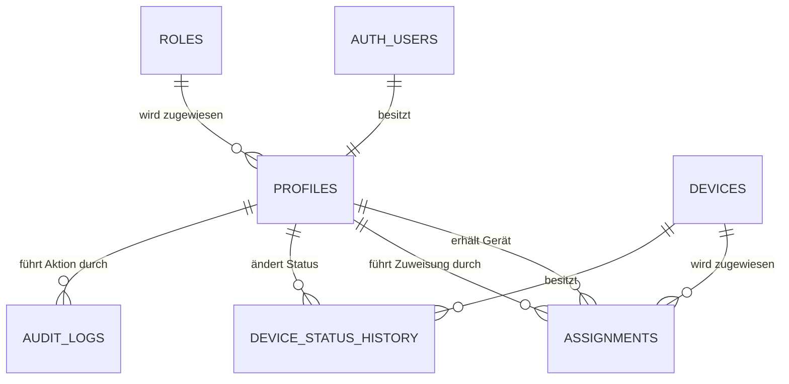

# Datenmodell – Device Inventory

## 1. Überblick

Für das Device Inventory wird eine relationale Datenbank verwendet. Die Datenbank bildet Benutzer, Rollen, Geräte, Gerätezuweisungen, Statusänderungen und Audit-Einträge ab.

Für den Kernumfang der Anwendung sind sechs zentrale Tabellen vorgesehen:

| Tabelle | Zweck |
|---|---|
| `roles` | Verwaltung der Benutzerrollen und Grundlage der rollenbasierten Berechtigungen |
| `profiles` | Speicherung der anwendungsspezifischen Benutzerdaten |
| `devices` | Speicherung und Verwaltung der IT-Geräte |
| `assignments` | Verwaltung aktueller und historischer Gerätezuweisungen |
| `device_status_history` | Historisierung der Statusänderungen eines Gerätes |
| `audit_logs` | Protokollierung relevanter Aktionen innerhalb der Anwendung |

Die Authentifizierungsdaten der Benutzer werden bei Verwendung von Supabase Auth zusätzlich über `auth.users` verwaltet. Die Tabelle `profiles` ergänzt diese Benutzer um die für das Device Inventory benötigten Informationen.

---

## 2. `roles`

Die Tabelle `roles` enthält die innerhalb des Device Inventory verfügbaren Benutzerrollen.

Vorgesehene Rollen sind:

- `admin`
- `device_manager`
- `employee`

### Aufgabe

Die Tabelle bildet die Grundlage für die rollenbasierte Zugriffskontrolle der Anwendung. Über die einem Benutzer zugewiesene Rolle wird bestimmt, welche Funktionen und Daten verwendet werden dürfen.

### Wichtige Attribute

| Attribut | Beschreibung |
|---|---|
| `id` | Eindeutige ID der Rolle |
| `name` | Eindeutiger Name der Rolle |
| `description` | Beschreibung der Rolle |

### Beziehung

```text
roles
  ▲
  │
  │ role_id
  │
profiles
```

---

## 3. `profiles`

Die Tabelle `profiles` enthält die anwendungsspezifischen Informationen eines Benutzers.

Bei Verwendung von Supabase Auth wird ein Profil über seine UUID mit dem entsprechenden Benutzer aus `auth.users` verknüpft.

### Aufgabe

Die Tabelle erweitert die Authentifizierungsdaten eines Benutzers um Informationen, die innerhalb des Device Inventory benötigt werden.

### Wichtige Attribute

| Attribut | Beschreibung |
|---|---|
| `id` | UUID des Benutzers und Referenz auf `auth.users.id` |
| `role_id` | Zugewiesene Benutzerrolle |
| `first_name` | Vorname |
| `last_name` | Nachname |
| `created_at` | Zeitpunkt der Erstellung |
| `updated_at` | Zeitpunkt der letzten Änderung |

### Beziehungen

```text
auth.users.id
      │
      │ 1:1
      ▼
profiles.id

profiles.role_id
      │
      ▼
roles.id
```

---

## 4. `devices`

Die Tabelle `devices` enthält die Stammdaten aller im Device Inventory verwalteten IT-Geräte.

### Aufgabe

Sie bildet den zentralen Gerätebestand der Anwendung ab. Jedes Gerät besitzt eine eindeutige Identifikation und einen aktuellen Status.

### Wichtige Attribute

| Attribut | Beschreibung |
|---|---|
| `id` | Eindeutige UUID des Gerätes |
| `asset_tag` | Unternehmensinterne Geräte- bzw. Inventarnummer |
| `serial_number` | Seriennummer des Gerätes |
| `device_type` | Art des Gerätes, z. B. Laptop, Smartphone oder Tablet |
| `manufacturer` | Hersteller |
| `model` | Modellbezeichnung |
| `status` | Aktueller Gerätestatus |
| `created_at` | Zeitpunkt der Erstellung |
| `updated_at` | Zeitpunkt der letzten Änderung |

### Vorgesehene Status

- `available`
- `assigned`
- `defective`
- `maintenance`
- `retired`

### Beziehungen

Ein Gerät kann im Laufe seines Lebenszyklus mehrere Zuweisungen und mehrere Statusänderungen besitzen.

```text
devices
   │
   ├──► assignments
   │
   └──► device_status_history
```

---

## 5. `assignments`

Die Tabelle `assignments` verwaltet die Zuweisung von Geräten an Mitarbeiter.

Sie enthält sowohl aktuelle als auch bereits abgeschlossene Zuweisungen und dient dadurch gleichzeitig als Zuweisungshistorie.

### Aufgabe

Mit der Tabelle kann nachvollzogen werden:

- welches Gerät zugewiesen wurde,
- welchem Mitarbeiter es zugewiesen wurde,
- wann die Zuweisung erfolgte,
- wer die Zuweisung durchgeführt hat,
- wann das Gerät zurückgegeben wurde,
- wer die Rückgabe durchgeführt hat.

### Wichtige Attribute

| Attribut | Beschreibung |
|---|---|
| `id` | Eindeutige UUID der Zuweisung |
| `device_id` | Zugewiesenes Gerät |
| `employee_id` | Mitarbeiter, dem das Gerät zugewiesen wurde |
| `assigned_by` | Benutzer, der die Zuweisung durchgeführt hat |
| `assigned_at` | Zeitpunkt der Zuweisung |
| `returned_at` | Zeitpunkt der Rückgabe |
| `returned_by` | Benutzer, der die Rückgabe durchgeführt hat |
| `created_at` | Zeitpunkt der Erstellung |

### Aktive Zuweisung

Eine Zuweisung gilt als aktiv, solange kein Rückgabezeitpunkt vorhanden ist:

```text
returned_at = NULL
```

Nach einer Rückgabe bleibt der Datensatz bestehen. Dadurch können vergangene Zuweisungen weiterhin nachvollzogen werden.

### Beziehungen

```text
devices.id
    │
    └──► assignments.device_id

profiles.id
    │
    ├──► assignments.employee_id
    ├──► assignments.assigned_by
    └──► assignments.returned_by
```

Ein Gerät darf gleichzeitig nur eine aktive Zuweisung besitzen.

---

## 6. `device_status_history`

Die Tabelle `device_status_history` speichert die Statusänderungen eines Gerätes.

### Aufgabe

Sie ermöglicht die Nachvollziehbarkeit des Device Lifecycle. Dadurch kann später festgestellt werden, wann sich ein Gerät in welchem Zustand befunden hat und wer eine Statusänderung durchgeführt hat.

### Wichtige Attribute

| Attribut | Beschreibung |
|---|---|
| `id` | Eindeutige UUID des Historieneintrags |
| `device_id` | Betroffenes Gerät |
| `old_status` | Vorheriger Status |
| `new_status` | Neuer Status |
| `changed_by` | Benutzer, der die Änderung durchgeführt hat |
| `changed_at` | Zeitpunkt der Statusänderung |

### Beispiel

```text
available
    │
    ▼
assigned
    │
    ▼
maintenance
    │
    ▼
available
    │
    ▼
retired
```

### Beziehungen

```text
devices.id
    │
    └──► device_status_history.device_id

profiles.id
    │
    └──► device_status_history.changed_by
```

---

## 7. `audit_logs`

Die Tabelle `audit_logs` protokolliert relevante Aktionen innerhalb des Device Inventory.

### Aufgabe

Das Audit-Log dient der Nachvollziehbarkeit von Änderungen und sicherheitsrelevanten Aktionen innerhalb der Anwendung.

Beispielsweise können folgende Aktionen protokolliert werden:

- Gerät erstellt
- Gerät bearbeitet
- Gerätestatus geändert
- Gerät zugewiesen
- Gerät zurückgegeben
- Benutzer erstellt
- Benutzer deaktiviert
- Benutzerrolle geändert

### Wichtige Attribute

| Attribut | Beschreibung |
|---|---|
| `id` | Eindeutige UUID des Audit-Eintrags |
| `user_id` | Benutzer, der die Aktion durchgeführt hat |
| `action` | Art der durchgeführten Aktion |
| `entity_type` | Art des betroffenen Objekts |
| `entity_id` | ID des betroffenen Objekts |
| `details` | Zusätzliche Informationen zur Aktion |
| `created_at` | Zeitpunkt der Aktion |

Das Feld `details` kann beispielsweise als `jsonb` umgesetzt werden, sodass zusätzliche Informationen flexibel gespeichert werden können.

### Beispiel

```json
{
  "action": "DEVICE_ASSIGNED",
  "entity_type": "device",
  "details": {
    "employee_id": "..."
  }
}
```

---

## 8. Beziehungen der Tabellen

Die zentralen Beziehungen des Datenmodells lassen sich wie folgt darstellen:



Vereinfacht ergibt sich folgende Struktur:

```text
                        roles
                          ▲
                          │
auth.users ─────────► profiles
                       │  │
             ┌─────────┘  └───────────────┐
             │                            │
             ▼                            ▼
       assignments                  audit_logs
             ▲
             │
             │
          devices
             │
             ▼
   device_status_history
```

---

## 9. Optionale Erweiterungen

Das Datenmodell kann im weiteren Projektverlauf um zusätzliche Tabellen erweitert werden.

Eine mögliche Erweiterung ist beispielsweise:

### `maintenance`

Zur Verwaltung von Defekten und Wartungsvorgängen könnten unter anderem folgende Informationen gespeichert werden:

- betroffenes Gerät
- Art der Wartung
- Beschreibung
- Wartungsstatus
- geplanter Wartungstermin
- Beginn der Wartung
- Abschluss der Wartung
- verantwortlicher Benutzer

Diese Erweiterung ist nicht Bestandteil des initialen Datenmodells und kann abhängig vom Projektfortschritt umgesetzt werden.

---

## 10. Zusammenfassung

Das initiale Datenmodell des Device Inventory besteht aus sechs zentralen Tabellen:

```text
roles
profiles
devices
assignments
device_status_history
audit_logs
```

Die Tabellen bilden gemeinsam die Benutzer- und Rollenverwaltung, den Gerätebestand, Gerätezuweisungen, den Device Lifecycle sowie die Nachvollziehbarkeit relevanter Änderungen ab.

Durch die Trennung der einzelnen Verantwortlichkeiten bleibt das Datenmodell erweiterbar und kann im weiteren Projektverlauf beispielsweise um Wartungen, Reservierungen oder weitere Geräteinformationen ergänzt werden.