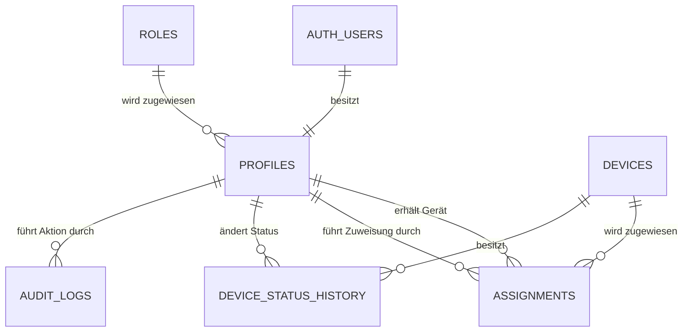

# Datenmodell – Device Inventory

## 1. Überblick

Für das Device Inventory wird eine relationale Datenbank verwendet. Die Datenbank bildet Benutzer, Rollen, Geräte, Gerätezuweisungen, Statusänderungen und Audit-Einträge ab.

Für den Kernumfang der Anwendung sind sechs zentrale Tabellen vorgesehen:

| Tabelle | Zweck |
|---|---|
| `roles` | Verwaltung der Benutzerrollen und Grundlage der rollenbasierten Berechtigungen |
| `profiles` | Speicherung der anwendungsspezifischen Benutzerdaten |
| `devices` | Speicherung und Verwaltung der IT-Geräte |
| `assignments` | Verwaltung aktueller und historischer Gerätezuweisungen |
| `device_status_history` | Historisierung der Statusänderungen eines Gerätes |
| `audit_logs` | Protokollierung relevanter Aktionen innerhalb der Anwendung |

Die Authentifizierungsdaten der Benutzer werden bei Verwendung von Supabase Auth zusätzlich über `auth.users` verwaltet. Die Tabelle `profiles` ergänzt diese Benutzer um die für das Device Inventory benötigten Informationen.

---

## 2. `roles`

Die Tabelle `roles` enthält die innerhalb des Device Inventory verfügbaren Benutzerrollen.

Vorgesehene Rollen sind:

- `admin`
- `device_manager`
- `employee`

### Aufgabe

Die Tabelle bildet die Grundlage für die rollenbasierte Zugriffskontrolle der Anwendung. Über die einem Benutzer zugewiesene Rolle wird bestimmt, welche Funktionen und Daten verwendet werden dürfen.

### Wichtige Attribute

| Attribut | Beschreibung |
|---|---|
| `id` | Eindeutige ID der Rolle |
| `name` | Eindeutiger Name der Rolle |
| `description` | Beschreibung der Rolle |

### Beziehung

```text
roles
  ▲
  │
  │ role_id
  │
profiles
```

---

## 3. `profiles`

Die Tabelle `profiles` enthält die anwendungsspezifischen Informationen eines Benutzers.

Bei Verwendung von Supabase Auth wird ein Profil über seine UUID mit dem entsprechenden Benutzer aus `auth.users` verknüpft.

### Aufgabe

Die Tabelle erweitert die Authentifizierungsdaten eines Benutzers um Informationen, die innerhalb des Device Inventory benötigt werden.

### Wichtige Attribute

| Attribut | Beschreibung |
|---|---|
| `id` | UUID des Benutzers und Referenz auf `auth.users.id` |
| `role_id` | Zugewiesene Benutzerrolle |
| `first_name` | Vorname |
| `last_name` | Nachname |
| `created_at` | Zeitpunkt der Erstellung |
| `updated_at` | Zeitpunkt der letzten Änderung |

### Beziehungen

```text
auth.users.id
      │
      │ 1:1
      ▼
profiles.id

profiles.role_id
      │
      ▼
roles.id
```

---

## 4. `devices`

Die Tabelle `devices` enthält die Stammdaten aller im Device Inventory verwalteten IT-Geräte.

### Aufgabe

Sie bildet den zentralen Gerätebestand der Anwendung ab. Jedes Gerät besitzt eine eindeutige Identifikation und einen aktuellen Status.

### Wichtige Attribute

| Attribut | Beschreibung |
|---|---|
| `id` | Eindeutige UUID des Gerätes |
| `asset_tag` | Unternehmensinterne Geräte- bzw. Inventarnummer |
| `name` | Anzeigename des Gerätes |
| `device_type` | Art des Gerätes, z. B. Laptop, Smartphone oder Tablet |
| `manufacturer` | Hersteller |
| `model` | Modellbezeichnung |
| `serial_number` | Seriennummer des Gerätes |
| `operating_system` | Betriebssystem |
| `processor` | Prozessor des Gerätes |
| `ram_gb` | Arbeitsspeicher in GB |
| `disk_space_gb` | Speicherplatz in GB |
| `location` | Standort des Gerätes |
| `device_usage` | . |
| `status` | Aktueller Gerätestatus |
| `purchased_at` | Kaufdatum des Gerätes |
| `start_of_use` | Datum der Inbetriebnahme |
| `maintenance_end` | Enddatum des Wartungsvertrages |
| `describtion` | Beschreibung des Gerätes |
| `comments` | Zusätzliche Kommentare |
| `created_by` | Benutzer, der das Gerät angelegt hat |
| `created_at` | Zeitpunkt der Erstellung |
| `updated_at` | Zeitpunkt der letzten Änderung |

### Vorgesehene Status

- `available`
- `assigned`
- `defective`
- `maintenance`
- `retired`

### Beziehungen

Ein Gerät kann im Laufe seines Lebenszyklus mehrere Zuweisungen und mehrere Statusänderungen besitzen.

```text
devices
   │
   ├──► assignments
   │
   └──► device_status_history
```

---

## 5. `assignments`

Die Tabelle `assignments` verwaltet die Zuweisung von Geräten an Mitarbeiter.

Sie enthält sowohl aktuelle als auch bereits abgeschlossene Zuweisungen und dient dadurch gleichzeitig als Zuweisungshistorie.

### Aufgabe

Mit der Tabelle kann nachvollzogen werden:

- welches Gerät zugewiesen wurde,
- welchem Mitarbeiter es zugewiesen wurde,
- wann die Zuweisung erfolgte,
- wer die Zuweisung durchgeführt hat,
- wann das Gerät zurückgegeben wurde,
- wer die Rückgabe durchgeführt hat.

### Wichtige Attribute

| Attribut | Beschreibung |
|---|---|
| `id` | Eindeutige UUID der Zuweisung |
| `device_id` | Zugewiesenes Gerät |
| `employee_id` | Mitarbeiter, dem das Gerät zugewiesen wurde |
| `assigned_by` | Benutzer, der die Zuweisung durchgeführt hat |
| `assigned_at` | Zeitpunkt der Zuweisung |
| `returned_at` | Zeitpunkt der Rückgabe |
| `returned_by` | Benutzer, der die Rückgabe durchgeführt hat |
| `created_at` | Zeitpunkt der Erstellung |

### Aktive Zuweisung

Eine Zuweisung gilt als aktiv, solange kein Rückgabezeitpunkt vorhanden ist:

```text
returned_at = NULL
```

Nach einer Rückgabe bleibt der Datensatz bestehen. Dadurch können vergangene Zuweisungen weiterhin nachvollzogen werden.

### Beziehungen

```text
devices.id
    │
    └──► assignments.device_id

profiles.id
    │
    ├──► assignments.employee_id
    ├──► assignments.assigned_by
    └──► assignments.returned_by
```

Ein Gerät darf gleichzeitig nur eine aktive Zuweisung besitzen.

### Historie und Schutz (PBI-12)

Zuweisungen bilden zusammen mit `device_status_history` die Gerätehistorie (**FA-14**). Damit historische Daten nach einer Rückgabe erhalten bleiben, gilt seit `supabase/proposals/20261123_pbi_12_device_history.sql`:

- Browser-Rollen dürfen `assignments` nicht direkt schreiben; Zuweisung und Rücknahme laufen nur über `inventory_assign_device` und `inventory_return_device`.
- Aktive Zuweisungen dürfen geändert werden (Rücknahme). Abgeschlossene Zuweisungen sind unveränderlich, Zuweisungen werden nie gelöscht (Trigger, auch für den Datenbankbesitzer). Einzige Ausnahme: `ON DELETE SET NULL` eines Benutzerbezugs, wenn das Profil gelöscht wird.
- Ein Gerät mit Historie kann daher nicht gelöscht werden; es wird stattdessen ausgemustert (`retired`).

---

## 6. `device_status_history`

Die Tabelle `device_status_history` speichert die Statusänderungen eines Gerätes.

### Aufgabe

Sie ermöglicht die Nachvollziehbarkeit des Device Lifecycle. Dadurch kann später festgestellt werden, wann sich ein Gerät in welchem Zustand befunden hat und wer eine Statusänderung durchgeführt hat.

### Wichtige Attribute

| Attribut | Beschreibung |
|---|---|
| `id` | Eindeutige UUID des Historieneintrags |
| `device_id` | Betroffenes Gerät |
| `old_status` | Vorheriger Status |
| `new_status` | Neuer Status |
| `changed_by` | Benutzer, der die Änderung durchgeführt hat |
| `changed_at` | Zeitpunkt der Statusänderung |

### Beispiel

```text
available
    │
    ▼
assigned
    │
    ▼
maintenance
    │
    ▼
available
    │
    ▼
retired
```

### Beziehungen

```text
devices.id
    │
    └──► device_status_history.device_id

profiles.id
    │
    └──► device_status_history.changed_by
```

### Schutz und Anzeige (PBI-12)

Einträge der Statushistorie entstehen ausschließlich in den Funktionen für Statuswechsel, Zuweisung und Rücknahme. Sie sind unveränderlich (Trigger gegen `UPDATE`, `DELETE` und `TRUNCATE`; Ausnahme nur `ON DELETE SET NULL` von `changed_by`).

Die RPC `public.inventory_device_history(target_device)` liefert die Historie eines Gerätes:

- Zuweisungen mit Mitarbeiter, Beginn, Ende sowie ausgebendem und zurücknehmendem Benutzer,
- Statusänderungen mit altem und neuem Status, Zeitpunkt und Benutzer.

Beide Listen sind neueste zuerst sortiert, auf je 200 Einträge begrenzt und enthalten vollständige Gesamtzahlen. Lesen dürfen Gerätemanager, Administratoren und SuperAdmins mit aktivem Konto, aktiver Sitzung sowie den Berechtigungen `devices:view_all` und `assignments:view_all`.

---

## 7. `audit_logs`

Die Tabelle `audit_logs` protokolliert relevante Aktionen innerhalb des Device Inventory (PBI-15, **FA-20**, **FA-21**).

### Aufgabe

Das Audit-Log macht Änderungen und sicherheitsrelevante Aktionen nachvollziehbar: **wer** (ausführender Benutzer), **was** (Aktion und betroffenes Objekt) und **wann** (Zeitpunkt). Administratoren sehen alle Einträge auf der Seite **Audit-Log**, die Einträge eines Gerätes zusätzlich in dessen Details unter **Änderungsprotokoll**.

### Wichtige Attribute

| Attribut | Beschreibung |
|---|---|
| `id` | Eindeutige UUID des Audit-Eintrags |
| `user_id` | Ausführender Benutzer (`profiles.id`); leer, wenn kein Benutzer ermittelt werden kann („System“) |
| `action` | Art der durchgeführten Aktion (Pflichtfeld) |
| `entity_type` | Art des betroffenen Objekts: `device`, `user` oder `role` (Pflichtfeld) |
| `entity_id` | UUID des betroffenen Objekts (bei Rollen leer) |
| `entity_title` | Lesbare Bezeichnung zum Zeitpunkt der Aktion, z. B. Inventarnummer, Name oder Rollenname |
| `details` | Zusätzliche Informationen als `jsonb` |
| `created_at` | Zeitpunkt der Aktion (Pflichtfeld) |

### Protokollierte Aktionen

| Aktion | Anzeige | Auslöser | `entity_type` | Inhalt von `details` |
|---|---|---|---|---|
| `DEVICE_CREATED` | Gerät angelegt | Gerät angelegt | `device` | Gerätedaten |
| `DEVICE_UPDATED` | Gerätedaten geändert | Stammdaten geändert (ohne Status) | `device` | `changes` mit altem und neuem Wert je Feld |
| `DEVICE_STATUS_CHANGED` | Gerätestatus geändert | Status geändert (auch durch Zuweisung/Rücknahme) | `device` | `old_status`, `new_status` |
| `DEVICE_DELETED` | Gerät gelöscht | Gerät gelöscht | `device` | Gerätedaten |
| `DEVICE_ASSIGNED` | Gerät zugewiesen | Zuweisung angelegt | `device` | `assignment_id`, `employee_id`, `employee_name`, `assigned_at` |
| `DEVICE_RETURNED` | Gerät zurückgenommen | Rückgabezeitpunkt gesetzt | `device` | `assignment_id`, `employee_id`, `employee_name`, `assigned_at`, `returned_at` |
| `ASSIGNMENT_UPDATED` | Zuweisung korrigiert | sonstige Änderung einer Zuweisung | `device` | `assignment_id`, `changes` |
| `ASSIGNMENT_DELETED` | Zuweisung gelöscht | Zuweisung gelöscht | `device` | Zuweisungsdaten |
| `USER_CREATED` | Benutzer angelegt | Profil angelegt | `user` | `first_name`, `last_name`, `role`, `email` |
| `USER_UPDATED` | Benutzerdaten geändert | Profildaten geändert | `user` | `changes` mit altem und neuem Wert je Feld |
| `USER_ROLE_CHANGED` | Benutzerrolle geändert | Rolle geändert | `user` | `old_role`, `new_role` |
| `USER_DISABLED` | Benutzer deaktiviert | `disabled_at` gesetzt | `user` | `disabled_at` |
| `USER_ENABLED` | Benutzer reaktiviert | `disabled_at` entfernt | `user` | – |
| `USER_DELETED` | Benutzer gelöscht | Profil gelöscht | `user` | Profildaten |
| `ROLE_PERMISSIONS_CHANGED` | Rollenberechtigungen geändert | SuperAdmin ändert Rechte einer Rolle | `role` | `role`, `permissions` (neuer, sortierter Stand) |

Zuweisungen und Rückgaben werden beim betroffenen Gerät protokolliert (`entity_type = 'device'`, `entity_id` = Geräte-ID). Dadurch zeigt die Gerätedetailseite alle Einträge eines Gerätes, während die Seite **Audit-Log** alle Einträge anzeigt. Der Mitarbeitername wird als Momentaufnahme gespeichert. Aktualisierungen ohne fachliche Änderung, z. B. nur `updated_at`, erzeugen keinen Eintrag. Neue Spalten in `devices`, `assignments` oder `profiles` erscheinen automatisch in `changes`.

### Umsetzung

Die Einträge werden durch Datenbank-Trigger auf `devices`, `assignments`, `profiles` und `inventory_private.role_change_audit` geschrieben (Proposal `supabase/proposals/20261123_pbi_15_audit_log.sql`). Damit wird jede Änderung protokolliert, egal auf welchem Weg sie in die Datenbank gelangt: Browser, RPC oder Supabase-Dashboard. Der Audit-Eintrag ist Teil derselben Transaktion: Wird die Änderung zurückgerollt, entfällt auch der Eintrag (**NFA-06**).

Der ausführende Benutzer wird über `auth.uid()` aus der Supabase-Sitzung ermittelt. Ohne Benutzersitzung werden fachliche Rückfallwerte verwendet:

- bei Zuweisungen `assigned_by`,
- bei Rückgaben `returned_by`,
- bei neuen Konten `app_metadata.created_by`, falls die Edge Function diesen Wert setzt.

Es werden nur IDs mit vorhandenem Profil übernommen, damit der Fremdschlüssel nie die eigentliche Änderung abbricht. Lässt sich kein Benutzer ermitteln, etwa bei Änderungen im Supabase-Dashboard, wird der Eintrag trotzdem geschrieben, mit leerem `user_id` („System“).

Die Funktionen liegen im nicht über die API erreichbaren Schema `inventory_private`. Das Proposal ersetzt die nie gemergten Migrationen `20261024120000_audit_logging.sql` und `20261024130000_audit_log_read_access.sql` und entfernt deren Objekte, falls sie bereits ausgeführt wurden.

### Manipulationsschutz

- Browser-Rollen (`anon`, `authenticated`) haben keinerlei direkte Rechte auf `audit_logs`. Der Service-Key kann nur lesen.
- Ein Trigger verhindert `UPDATE`, `DELETE` und `TRUNCATE`, auch für den Datenbankbesitzer. Einzige Ausnahme ist `ON DELETE SET NULL` von `user_id`, wenn das Profil des ausführenden Benutzers gelöscht wird.

### Berechtigungen

| Rolle | Lesen | Anlegen, Ändern, Löschen |
|---|---|---|
| SuperAdmin | alle Einträge (mit `audit:view`) | nein |
| Administrator | alle Einträge (mit `audit:view`) | nein |
| Gerätemanager | nein | nein |
| Mitarbeiter | nein | nein |
| nicht angemeldet | nein | nein |

Gelesen wird ausschließlich über die RPC `public.inventory_audit_log_list(target_page, target_action, target_entity_type, target_entity_id, search_text, created_from, created_to)`. Sie prüft bei jedem Aufruf:

- angemeldeter Benutzer mit aktivem Konto,
- aktive Serversitzung,
- Rolle `admin` oder `super_admin`,
- dynamische Berechtigung `audit:view`.

Wird die Rolle oder die Berechtigung entzogen, das Konto deaktiviert oder die Sitzung beendet, entfällt der Zugriff sofort. Die RPC filtert nach Aktion, Objekttyp, Objekt, Zeitraum und Suchbegriff und liefert Seiten zu je 25 Einträgen (neueste zuerst) mit Gesamtzahl.

### Beispiel

```json
{
  "user_id": "…",
  "action": "DEVICE_ASSIGNED",
  "entity_type": "device",
  "entity_id": "…",
  "entity_title": "IT-0003",
  "details": {
    "assignment_id": "…",
    "employee_id": "…",
    "employee_name": "Erika Muster",
    "assigned_at": "2026-11-23T12:00:00+00:00"
  },
  "created_at": "2026-11-23T12:00:00+00:00"
}
```

---

## 8. Beziehungen der Tabellen

Die zentralen Beziehungen des Datenmodells lassen sich wie folgt darstellen:



Vereinfacht ergibt sich folgende Struktur:

```text
                        roles
                          ▲
                          │
auth.users ─────────► profiles
                       │  │
             ┌─────────┘  └───────────────┐
             │                            │
             ▼                            ▼
       assignments                  audit_logs
             ▲
             │
             │
          devices
             │
             ▼
   device_status_history
```

---

## 9. Optionale Erweiterungen

Das Datenmodell kann im weiteren Projektverlauf um zusätzliche Tabellen erweitert werden.

Eine mögliche Erweiterung ist beispielsweise:

### `maintenance`

Zur Verwaltung von Defekten und Wartungsvorgängen könnten unter anderem folgende Informationen gespeichert werden:

- betroffenes Gerät
- Art der Wartung
- Beschreibung
- Wartungsstatus
- geplanter Wartungstermin
- Beginn der Wartung
- Abschluss der Wartung
- verantwortlicher Benutzer

Diese Erweiterung ist nicht Bestandteil des initialen Datenmodells und kann abhängig vom Projektfortschritt umgesetzt werden.

---

## 10. Zusammenfassung

Das initiale Datenmodell des Device Inventory besteht aus sechs zentralen Tabellen:

```text
roles
profiles
devices
assignments
device_status_history
audit_logs
```

Die Tabellen bilden gemeinsam die Benutzer- und Rollenverwaltung, den Gerätebestand, Gerätezuweisungen, den Device Lifecycle sowie die Nachvollziehbarkeit relevanter Änderungen ab.

Durch die Trennung der einzelnen Verantwortlichkeiten bleibt das Datenmodell erweiterbar und kann im weiteren Projektverlauf beispielsweise um Wartungen, Reservierungen oder weitere Geräteinformationen ergänzt werden.
